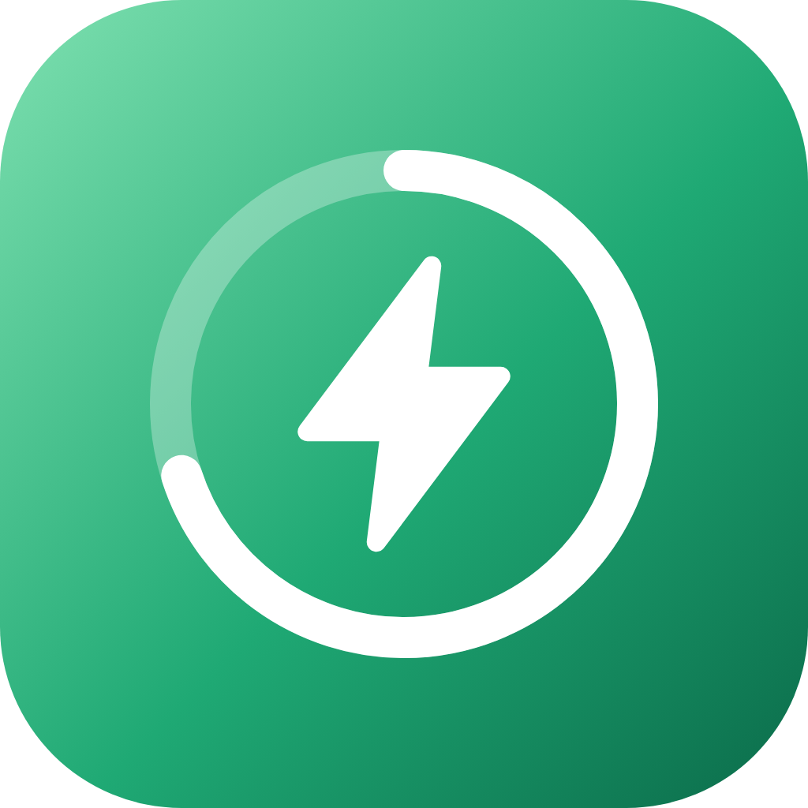
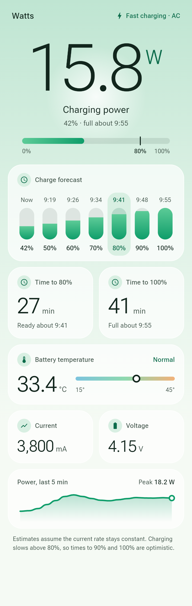
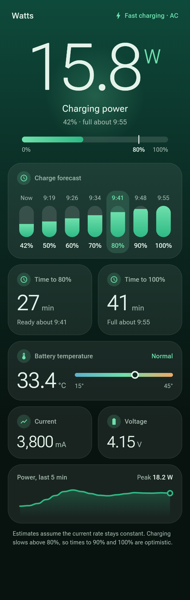
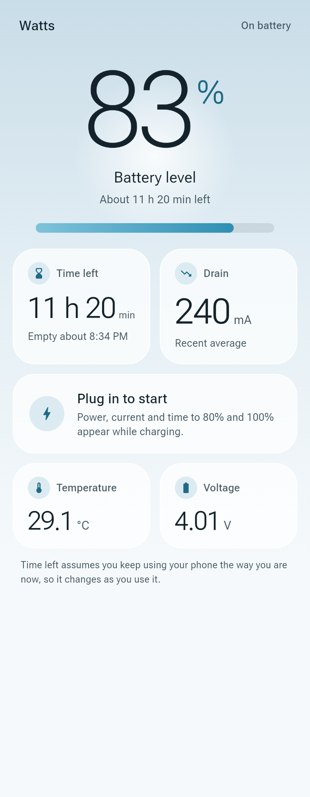

  

<h1 align="center">Watts</h1>

  <b>See how fast your phone is charging.</b> 
  Live charging power, time to 80% and 100%, and battery temperature.

  
  
  

  
  
  

## What you get

- **Charging power in watts.** A large live reading, with "Fast charging" shown at 15 W and above.
- **Time to 80% and 100%.** Minutes remaining and the clock time you can expect to be there.
- **Charge forecast.** The estimated time for each 10% step from 50% to 100%, with 80% highlighted.
- **Battery temperature.** The reading from the battery's own sensor, marked Normal, Warm or Hot.
- **Current and voltage.** In milliamps and volts.
- **Power history.** A chart of the last 5 minutes with the peak.
- **Light and dark.** Follows your phone's theme. Text follows your phone's text size.

## Private by design

No account, no ads, no analytics. The release app doesn't request internet access or any permission that Android prompts you for. Nothing is stored or sent anywhere. It only reads the battery state your phone already reports.

## Install

1. Open the [latest release](https://github.com/markprovan/watts/releases/latest) on your phone and download `Watts-v….apk`.
2. Open the file. If Android asks, allow installs from your browser or file manager.
3. Open Watts and plug in a charger.

Requires Android 7.0 or later. To update, install the newer APK over the old one. If you ever installed a test build from the Actions tab, uninstall it first, because test builds use a different signing key.

## How the numbers are worked out

- **Power** is the battery voltage multiplied by the charging current, smoothed over a few seconds so it doesn't jump around.
- **Time estimates** divide the charge still needed by the current charging rate. The battery's capacity comes from its own charge counter and level.
- **Estimates assume the rate stays the same.** Phones slow charging as the battery fills and warms up, so times to 90% and 100% are shorter than real life. The 80% estimate is usually closest.
- **Temperature status:** Normal below 38°C, Warm from 38°C, Hot from 42°C.

## Questions

The power is lower than my charger's label.

The label is the most the charger can supply. Your phone asks for what it needs, and asks for less as the battery fills, warms up or when you use it. Watts shows what the battery is receiving right now.

I see dashes instead of times.

Some phones don't report the charging current, or report too little for an estimate. Without it, Watts can't work out power or time. Temperature, voltage and the battery level still show.

Why does the forecast start at 50%?

The steps are 50%, 60%, 70%, 80%, 90% and 100%. Steps you have already passed are hidden, so the row shrinks as the battery charges.

Does it work with wireless and USB charging?

Yes. Watts reads the battery, not the charger, and shows the connection type next to "Charging" when your phone reports it.

## For developers

Building, testing, releasing and the project layout are in [docs/DEVELOPMENT.md](docs/DEVELOPMENT.md).

Roboto Flex is used under the SIL Open Font License ([assets/fonts/OFL.txt](assets/fonts/OFL.txt)).
